<div align="center">


# Nomen

**Paste a brand's website. A team of agents studies what is winning on short-form video, writes the campaign, makes the videos, finds real creators, posts, and comes back for the next round.**

[Walkthrough](#walkthrough) · [What it made](#what-it-made) · [Architecture](#architecture) · [Engineering](#interesting-engineering) · [Quick start](#quick-start)

<sub>Built at the Naïve × YC hackathon, November 7–8, 2026, on <a href="https://usenaive.ai">Naïve</a>, Monid and Mobilerun.</sub>

<br/>

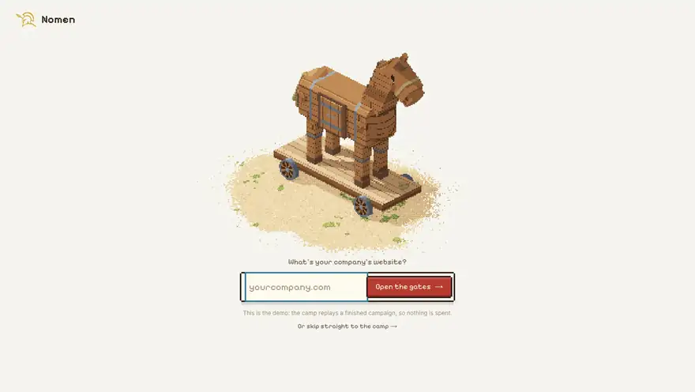

<sub>A real campaign for Naïve (usenaive.ai), replayed in the camp at <code>/demo</code>. Every number on screen comes from the recorded run.</sub>

</div>

## What it does

Nomen is an agent-run UGC studio. Given a website, it researches the brand, its competitors and the short-form videos that are outperforming their accounts; picks the formats worth copying; writes and produces original videos in those formats; checks every shot; lets a person approve each video or hand the brief to a real creator; posts to the brand's own accounts; and feeds the analytics into the next campaign. An autopilot starts that next campaign by itself, but only inside a weekly budget a person typed in.

The whole run is visible as a camp: each agent is a soldier walking between stations, and each station opens onto the work behind it.

| One recorded campaign: Naïve (usenaive.ai) | |
| :--- | :--- |
| Research jobs run | 42, across TikTok, Instagram, YouTube, Meta and TikTok ad libraries, Reddit, ChatGPT, Perplexity, SimilarWeb and Ahrefs |
| Found and screened | 100 short-form videos, 9 ads and 5 Reddit threads |
| Made | 4 videos in 4 formats, each built on a researched outlier video |
| Cast | 2 briefs approved for a real creator (7/10) by the client-taste agent, outreach drafted |
| Spent | $25.58 on Naïve and $1.19 on Monid, as recorded in `public/demo/usenaive-ai/script.json` |

## What it made

Each video started from a researched outlier: a video that got far more views than its account has followers. Captions show the format, the outlier it was built on, and what the video cost.

| Organic AI creator | 3D ad, animated in code | Brainrot meme |
| :---: | :---: | :---: |
| 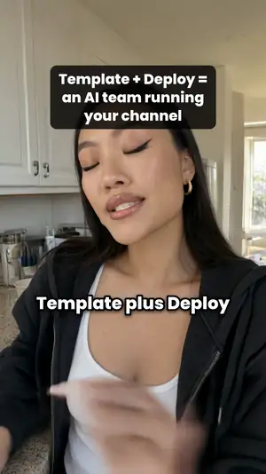 | 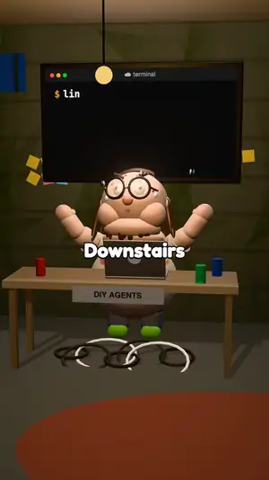 | 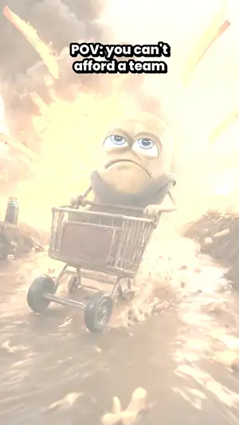 |
| [Template + Deploy = a team running your channel](public/demo/usenaive-ai/1.mp4)<br/><sub>Naïve · 20 s · $3.82 · outlier: 1.3M views on 6.2K followers</sub> | [Two founders, one instruction: make money](public/demo/usenaive-ai/3.mp4)<br/><sub>Naïve · 25 s · rendered in code · outlier: 644K views on 1.8K followers</sub> | [Gary the Potato Deploys a Company](public/demo/usenaive-ai/4.mp4)<br/><sub>Naïve · 37 s · $3.27 · outlier: 81M views on 235K followers</sub> |
|  |  |  |
| [Wait, what? Your agent can use tools it never signed up for](public/demo/monid-ai/2.mp4)<br/><sub>Monid · 21 s · $4.20 · outlier: 1.9M views on 1.0K followers</sub> | [Mid-curl, your agent sets up its own tools](public/demo/monid-ai/3.mp4)<br/><sub>Monid · 25 s · rendered in code · outlier: 1.2M views on 11.7K followers</sub> | [i let my agent cook with one balance (it got greedy)](public/demo/monid-ai/4.mp4)<br/><sub>Monid · 31 s · $2.49 · outlier: 2.3M views on 5.1K followers</sub> |

Each recorded campaign also made a one-to-one copy of a real creator's video, to test the clone pipeline. Copies are marked internal and held from posting, so they are not shown here. Earlier generations, with frame contact sheets and a written critique, are in [`samples/`](samples/monid/REVIEW.md).

## Walkthrough

The demo replays a recorded campaign at `/demo`; a live campaign shows the same camp at `/camp/<id>`. Stage by stage:

| 1 · Scouts fan out | 2 · The findings |
| :--- | :--- |
| 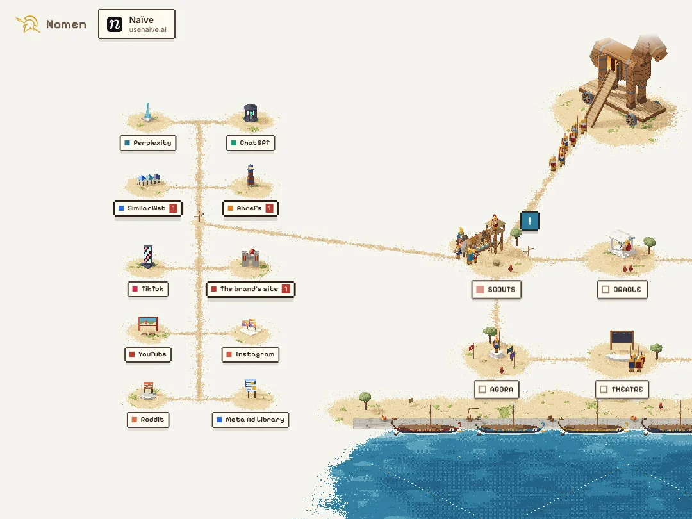 | 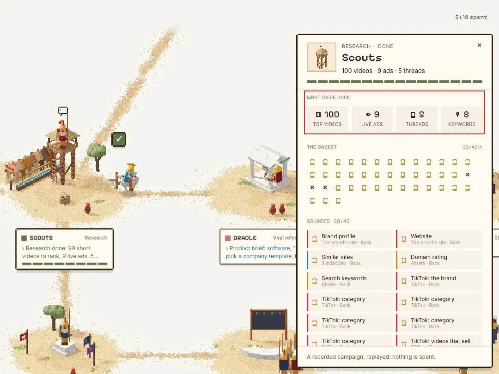 |
| A planner (Claude Haiku) turns the brand profile into about 35 research jobs on Monid; a scout adds up to 5 follow-up searches. | Every job is listed with what it returned and what it cost. Outliers are ranked by views against followers. |

| 3 · The oracle studies the outliers | 4 · The war tent |
| :--- | :--- |
| 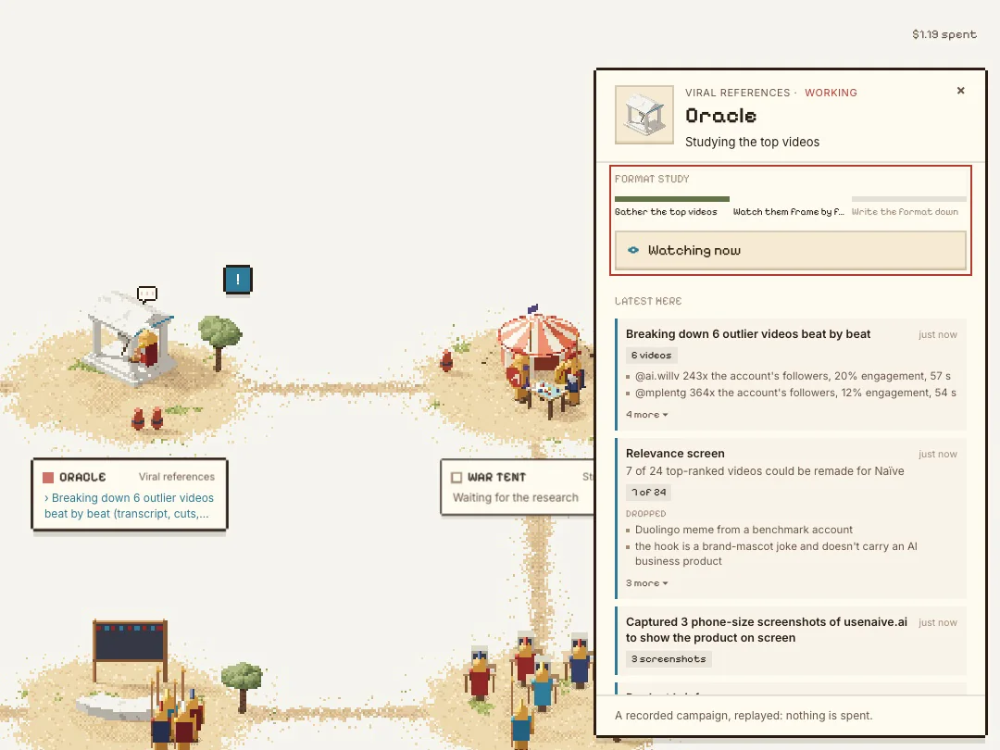 | 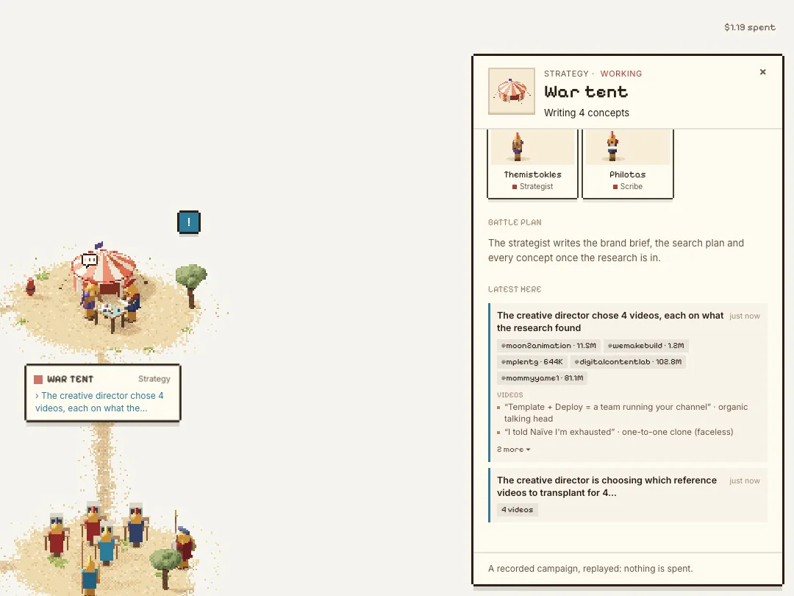 |
| A relevance screen keeps the top 20; six are broken down beat by beat, with speech-to-text and Claude vision on their frames. | The `nomen-director` agent on Naïve writes the strategy and picks the videos; a writer, a linter and a critic draft each script. |

| 5 · The workshop | 6 · The screening room |
| :--- | :--- |
| 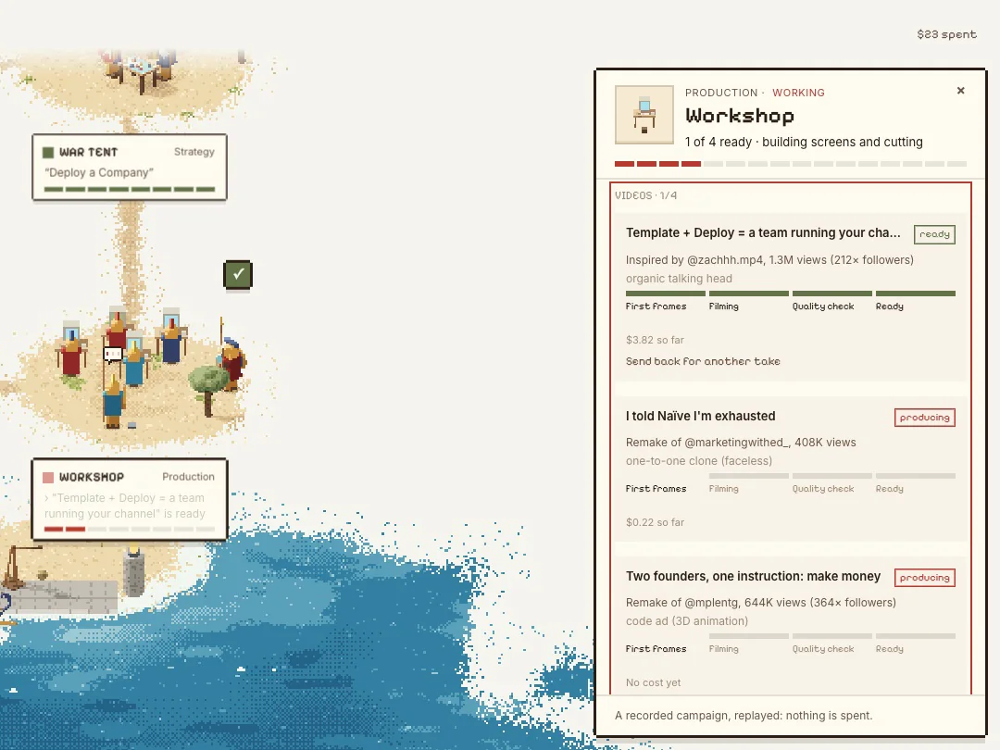 | 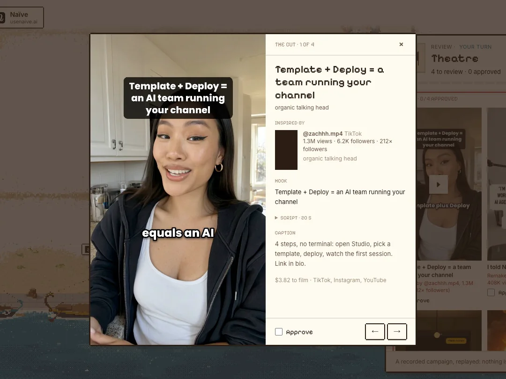 |
| First frame, a vision check on it, the render, a shot-by-shot quality check, product screens, a continuity check, then one ffmpeg pass for the cut and captions. | Each finished video plays beside the outlier it was built on, with the hook, caption and cost. Nothing posts until someone approves it. |

| 7 · Real creators | 8 · Posting, and the battle |
| :--- | :--- |
| 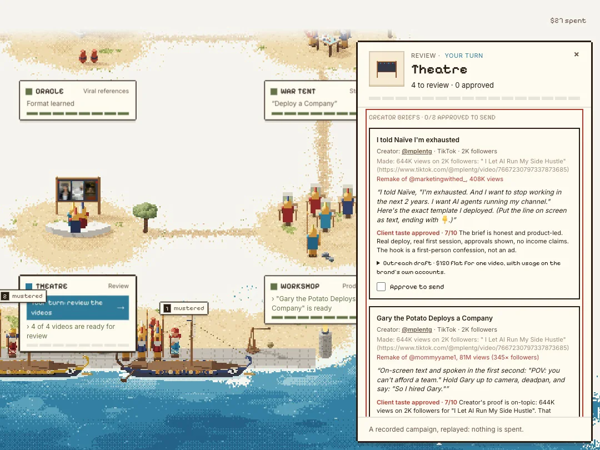 | 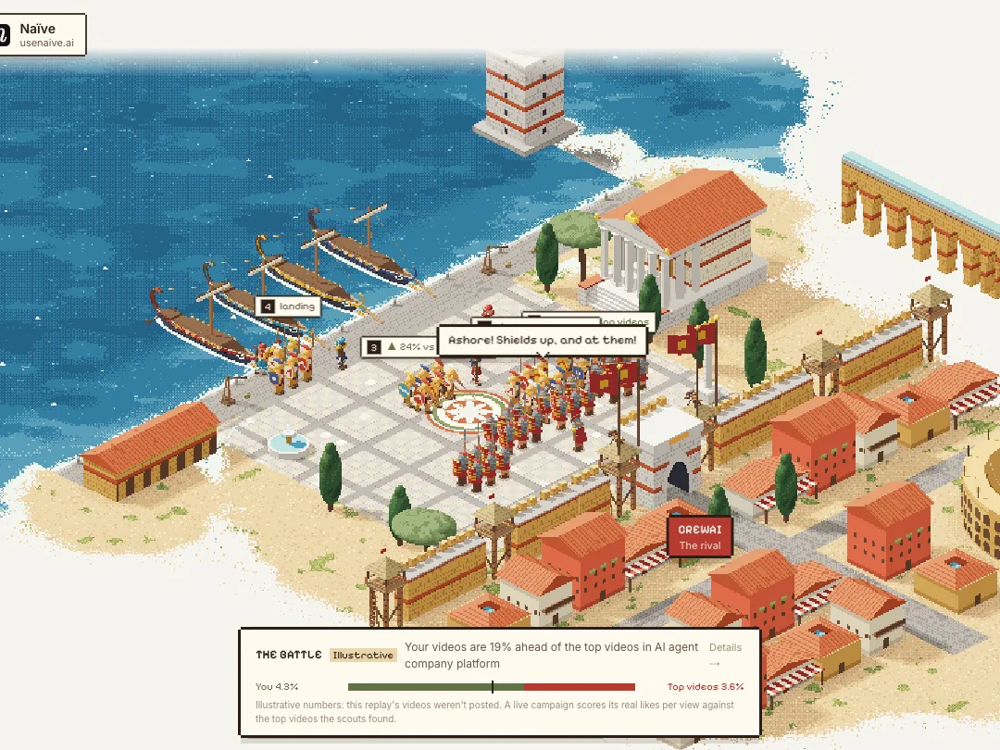 |
| In creators mode a brief goes to a person instead: casting ranks creators from the research, a client-taste agent approves one, and the DM is drafted for the brand's phone. | Approved videos post to the brand's accounts, labeled AI-generated, and the army sails for the rival's city. Analytics come back for 14 days and steer the next strategy. |

## Architecture

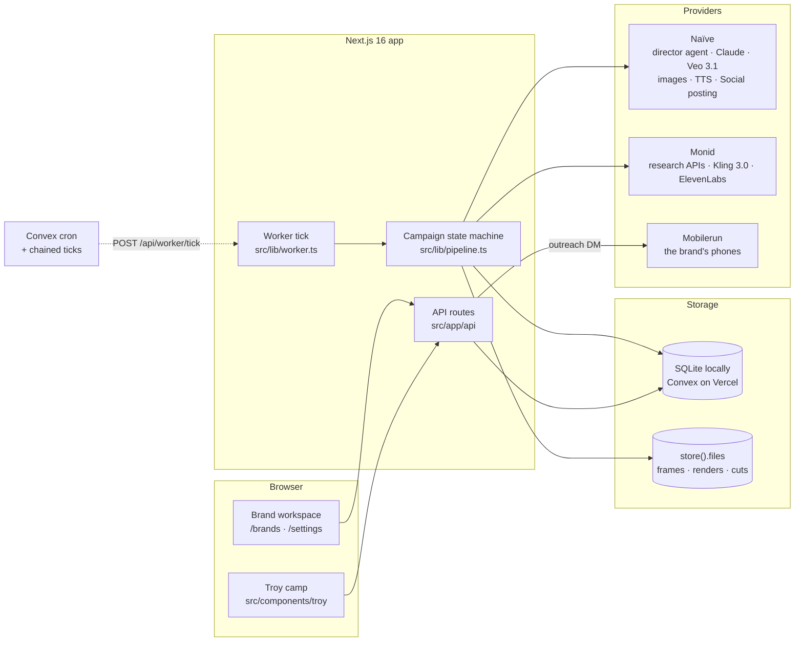

A campaign is one row moving through six stages, and the autopilot closes the loop:

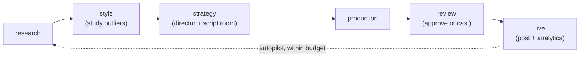

1. **Research** (`src/lib/research.ts`, `src/lib/creative/scout.ts`): the brand's own sources first (profile, site, SimilarWeb, Ahrefs), then a planned sweep of TikTok, Reels and Shorts searches, Meta and TikTok ad libraries, Reddit, and what ChatGPT and Perplexity answer about the category. Each job is a row in `monid_runs` before it is submitted (`src/lib/runs.ts`).
2. **Style** (`src/lib/creative/references.ts`): a relevance screen, then beat-by-beat breakdowns of the six best outliers.
3. **Strategy** (`src/lib/strategy.ts`, `naive/agents/director.md`): one structured session with the `nomen-director` agent (Claude Sonnet 5.5 on Naïve), fed the research, the breakdowns and past posts' analytics; then the script room (`src/lib/creative/script.ts`).
4. **Production** (`src/lib/production.ts`, `src/lib/creative/edit.ts`): frames, renders, quality checks, generated product screens and the cut. Renders go to Kling 3.0 on Monid by default, or Veo 3.1 on Naïve; when Naïve runs out of credits mid-campaign, shots move to Kling.
5. **Review** (`src/app/api/creatives/[id]`, `src/lib/creative/casting.ts`, `src/lib/phones/service.ts`): approve, edit the caption, re-render with a note, or cast a creator and send the drafted DM from the brand's phone.
6. **Live** (`src/lib/publish.ts`, `src/lib/loop.ts`): posts through Naïve Social with the AI-generated flag, reads analytics every 30 minutes for 14 days, and lets the autopilot decide whether the next campaign fits the budget.

## Interesting engineering

### A multi-hour pipeline on serverless functions

- **Problem**: a campaign is dozens of provider jobs that finish over a long time. Vercel functions are short-lived, and there is no worker process.
- **Approach**: every stage is written as a short, idempotent step. Locally an in-process loop ticks every 4 s (`src/lib/worker.ts`). On Vercel, Convex chains a tick every 10 s while campaigns or posts are in flight and a 5-minute cron restarts the chain (`convex/worker.ts`, `convex/crons.ts`); the tick route answers 202 and runs the work in `after()`, and a lease in the store stops two ticks overlapping. Any file a later tick needs goes through `store().files`, because the next tick may run on another machine.
- **Why**: no queue to run, an idle deployment costs one call every five minutes, and a crash costs time rather than money.
- **Tradeoff**: each step can wait up to 10 s to start, long edits press against the function time limit, and static ads, phones, brand kits and generated screens still run only on the local SQLite store (`docs/convex.md`).

### Never paying for the same render twice

- **Problem**: video renders cost dollars, and both server restarts and provider "busy" errors are routine.
- **Approach**: a research job is stored before it is submitted, unique on campaign and key (`src/lib/runs.ts`). Naïve sessions and shot renders carry idempotency keys derived from their state (`-qcN`, `-fixN`, `-cN` in `src/lib/production.ts`), so a retry gets the same provider job back. Retryable errors back off from 5 s to 5 min (`src/lib/pipeline.ts`).
- **Why**: a retried call should never become a second charge.
- **Tradeoff**: backoff timers live in memory, so the first retry after a restart can come early.

### Cheap checks in front of expensive renders

- **Problem**: a flawed still gets animated into a paid render, then copied into every later shot of the video.
- **Approach**: a vision check on each first frame before the video model sees it; after the render, shot QC passes at 7/10 and re-renders a failed shot with a corrected prompt, up to 2 times; a continuity check compares one frame per shot and re-renders a mismatched shot once from shot 1's identity (`src/lib/qc.ts`, `src/lib/production.ts`).
- **Why**: the frame check costs cents; the render it can save costs dollars.
- **Tradeoff**: when the QC model itself fails, the shot is passed rather than thrown away, so the gate is best-effort.

### A demo that replays a real run

- **Problem**: a live campaign costs about $27 and takes far longer than a two-minute demo.
- **Approach**: `npm run demo:export` turns a finished campaign (research, events, spend, videos, castings) into `public/demo/<id>/script.json`. The camp replays it on a clock, and the tour seeks forward step by step (`src/components/troy/camp/demo.ts`, `tour.ts`). `scripts/film-demo.cjs` films the replay one frame at a time on Playwright's fake clock, with no dropped frames.
- **Why**: everything on screen in the demo is the real run's data, shown at presentation speed.
- **Tradeoff**: the post analytics in the replay are illustrative, since the recorded videos were not posted at recording time.

## Video formats

| Format | What it is | Where the code is |
| :--- | :--- | :--- |
| Talking head with B-roll, split screen, presenter inset, voice-over demo, text story, filmed screen | AI presenter or voice-over videos from the script room | `main` (`src/lib/creative/types.ts`) |
| One-to-one remake | A reference re-filmed line for line with an AI presenter; internal, held from posting | `main` (`src/lib/creative/remake.ts`) |
| Static ad packs | Concepts with fact-checked copy, rendered at every platform size, downloaded as one ZIP | `main` (`src/lib/statics/`, [`docs/static-ads.md`](docs/static-ads.md)) |
| Organic AI creator | An original video on the research's best-performing formula | branch [`generators/organic-videos`](https://github.com/aiden-guan/Nomen/tree/generators/organic-videos) |
| 3D ad animated in code | Scripted scenes rendered in code, no video model | branch [`generators/code-ads`](https://github.com/aiden-guan/Nomen/tree/generators/code-ads) |
| Brainrot meme | A meme video generated shot by shot from the research's own memes | branch [`generators/brainrot-ads`](https://github.com/aiden-guan/Nomen/tree/generators/brainrot-ads) |
| Faceless one-to-one clone | Keeps the original's footage, with the brand in the caption; internal | branch [`generators/faceless-clones`](https://github.com/aiden-guan/Nomen/tree/generators/faceless-clones) |
| Posting from the brand's phone | Posts through Mobilerun with a sound from TikTok's library | branch [`generators/phone-posting`](https://github.com/aiden-guan/Nomen/tree/generators/phone-posting) |

The organic, code-ad, brainrot and clone generators were built in parallel and are not merged into `main` yet. Their finished videos were imported into the recorded campaigns with `tests/demo-import.seed.test.ts`.

## Technology stack

**Client**
- Next.js 16 (App Router), React 19, Tailwind CSS 4.
- The camp: a hand-built pixel-art scene engine with walkers, jobs and props (`src/components/troy/engine`), driven by the campaign's state (`src/components/troy/scenes/derive.ts`).

**Server and orchestration**
- Next.js API routes and an in-process worker; Convex calls the tick route on Vercel.
- Agents and models through Naïve: Claude Sonnet 5.5 (director, QC, scripts, breakdowns, casting), Claude Haiku 5.5 (planner, scout), Claude Opus 5.5 (static ads), Gemini 3 Pro Image, Veo 3.1, text-to-speech, and Naïve Social for posting.
- Monid for research APIs, Kling 3.0 renders and ElevenLabs voice; Mobilerun for the brand's phones.

**Media**
- ffmpeg for the single-pass edit with ASS captions; headless Chrome for generated product screens; optional Demucs stems (`npm run setup:stems`); `next/og` for static ads.

**Storage**
- SQLite (`better-sqlite3`) locally; Convex tables and file storage on Vercel, behind one store interface (`src/lib/store`).

**Tooling**
- Vitest and `convex-test`, TypeScript, a guarded Naïve CLI (`scripts/naive-guard.mjs`), Remotion for the demo edit (`video/`).

## Quick start

**Prerequisites:** Node.js 20.9 or later, and ffmpeg on your `PATH` (or `FFMPEG_PATH`). Google Chrome for generated product screens (optional, `CHROME_PATH`).

### Watch the demo (no keys)

```bash
git clone https://github.com/aiden-guan/Nomen.git
cd Nomen
npm install
npm run dev
```

Open [http://localhost:3000/demo](http://localhost:3000/demo) and type `naive.ai` or `monid.ai`. → and ← walk the tour, R restarts it, T hides it; add `?autoplay=1` to play it through.

### Run real campaigns

Real campaigns spend real money on Naïve and Monid. Budgets come from you.

```bash
cp .env.example .env.local          # NAIVE_API_KEY and MONID_API_KEY, or paste them in Settings later
npm run naive -- claim < key.txt    # once: bind the Naïve CLI to your organization (docs/naive.md)
npm run naive:plan                  # review the agents and their monthly caps
npm run naive:apply                 # once: create nomen-director on Naïve
npm run dev
```

Open [http://localhost:3000](http://localhost:3000), paste a website and start a campaign. The camp follows it at `/camp/<id>`; the classic workspace is at `/brands`, and Settings holds the keys, the video model, campaign size and Autopilot.

## Configuration

| Variable | Needed for | Read in |
| :--- | :--- | :--- |
| `NAIVE_API_KEY` | Strategy, images, QC, voice, posting | `src/lib/settings.ts` (or saved in Settings) |
| `MONID_API_KEY` | Research, Kling renders, ElevenLabs | `src/lib/settings.ts` (or saved in Settings) |
| `MOBILERUN_API_KEY` | The brand's phones and outreach DMs | `src/lib/settings.ts` |
| `FFMPEG_PATH`, `CHROME_PATH` | A specific ffmpeg or Chrome binary | `src/lib/media.ts`, `src/lib/creative/screens.ts` |
| `NOMEN_DB_PATH`, `NOMEN_WORKER=off` | Another SQLite file; no background worker | `src/lib/store/sqlite.ts`, `src/lib/worker.ts` |
| `CONVEX_DEPLOY_KEY`, `NEXT_PUBLIC_CONVEX_URL`, `NOMEN_SERVER_SECRET` | Running the core on Convex (Vercel) | `src/lib/store/index.ts`, `convex/auth.ts` |
| `SITE_PASSWORD`, `NOMEN_DEMO_ONLY=1` | A password gate; forcing demo-only mode on a hosted copy | `src/proxy.ts`, `src/lib/live.ts` |

Deploying to Vercel with Convex is covered in [`docs/convex.md`](docs/convex.md).

## Repository structure

```text
src/
├── app/                    # Pages (/, /demo, /camp/[id], /brands, /settings) and API routes
├── components/troy/        # The camp: scene engine, stations, panels, demo replay and tour
├── components/             # The classic brand workspace
└── lib/
    ├── pipeline.ts         # Campaign state machine: research → style → strategy → production → review → live
    ├── worker.ts           # The tick that drives it
    ├── research.ts         # The Monid research plan and fan-out
    ├── strategy.ts         # The contract with the nomen-director agent
    ├── production.ts       # Frames, renders, QC, continuity and the cut
    ├── creative/           # References, script room, casting, remakes, screens, edit, voice
    ├── statics/            # Static ad packs
    ├── phones/             # Mobilerun phones: warm-up and outreach
    ├── publish.ts          # Posting and analytics
    ├── loop.ts             # Autopilot and its budget gate
    └── store/              # SQLite and Convex stores, files by key
convex/                     # Convex schema, lease and tick cron
naive/ · naive.config.ts    # Naïve agents and resources, changed only through npm run naive
public/demo/                # Recorded campaigns the demo replays (Naïve, Monid)
samples/                    # Earlier generated videos with contact sheets and critiques
scripts/                    # Demo export and filming, guarded Naïve CLI, stems setup
video/                      # Remotion edit of the demo video
tests/                      # Vitest suites; live tests are opt-in
docs/                       # Engine, research, Convex, phones, static ads and camp notes
```

## Tests

```bash
npm test             # unit and integration tests, offline (in-memory SQLite, worker off)
npm run typecheck
```

On `main` at the time of writing: 57 test files, 697 tests passed and 18 skipped (the opt-in live ones), and `next build` passes.

Tests that call paid services only run when their variable is set, for example `NOMEN_CASTING_LIVE=1` (casting), `NOMEN_LIVE_STATICS` (static ads) or `MOBILERUN_LIVE=1` (read-only phone checks). Tests that need ffmpeg or Chrome skip themselves when those are missing.

## Rules Nomen keeps

- **Brand-owned accounts only.** Posting goes through accounts the brand connects itself; Nomen never creates accounts or posts as invented people.
- **Labeled.** Every post sets Naïve's `ai_generated` flag.
- **No fake testimonials.** Creators share the product; they never claim results or experiences that did not happen, and claims stay within what the brand's own site says.
- **Copies stay internal.** One-to-one remakes and clones are held from posting unless someone clears them.
- **A person approves.** Nothing posts until someone approves it, unless Autopilot is on with "Post automatically" ticked.
- **Budgets come from people.** Autopilot starts a campaign only within the weekly budget someone typed in; with no budget it never starts one (`src/lib/loop.ts`).

## Costs

Measured on the team's accounts in November 2026:

| Item | Cost |
| :--- | :--- |
| Research on Monid | $0.06–$1.19 per campaign |
| Director session (Claude Sonnet 5.5) on Naïve | about $0.20 |
| Veo 3.1 on Naïve | $0.40 per second of video |
| Kling 3.0 on Monid | $0.168 per second at 1080p with audio |
| A post through Naïve Social | $0.013, or $0.0325 when it includes X |
| A static ad pack (4 concepts at 14 sizes) | about $0.56 |
| The recorded Naïve and Monid campaigns, end to end | $26.77 and $27.78 |

## Status and limits

Nomen is a hackathon prototype. What that means today:

- The organic, 3D code-ad, brainrot and faceless-clone generators and phone posting live on `generators/*` branches and are not merged into `main`.
- The format study in `src/lib/format.ts` only runs from its live test; the style stage's work is the reference breakdowns.
- Post analytics shown in the demo replay are illustrative.
- The Mobilerun client has not been run against the live API end to end.
- On Vercel with Convex, static ads, phones, brand kits and generated screens do not run.
- Every real campaign needs paid Naïve and Monid keys.

More detail: [`docs/creative-engine.md`](docs/creative-engine.md), [`docs/research-steering.md`](docs/research-steering.md), [`docs/troy.md`](docs/troy.md), [`docs/phones.md`](docs/phones.md), [`docs/naive.md`](docs/naive.md). The changes are summarized in [`CHANGELOG.md`](CHANGELOG.md).

## Team

Built by [aiden-guan](https://github.com/aiden-guan) and [dylann29](https://github.com/dylann29). No license has been chosen yet.
