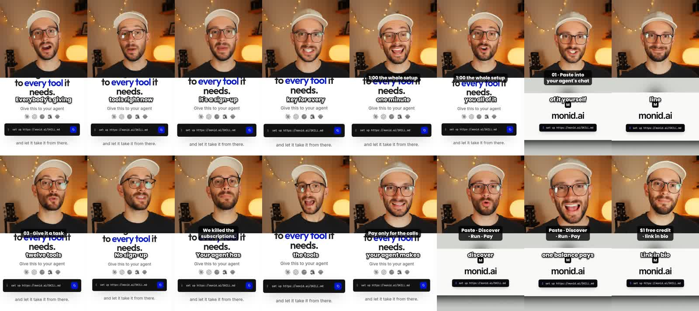
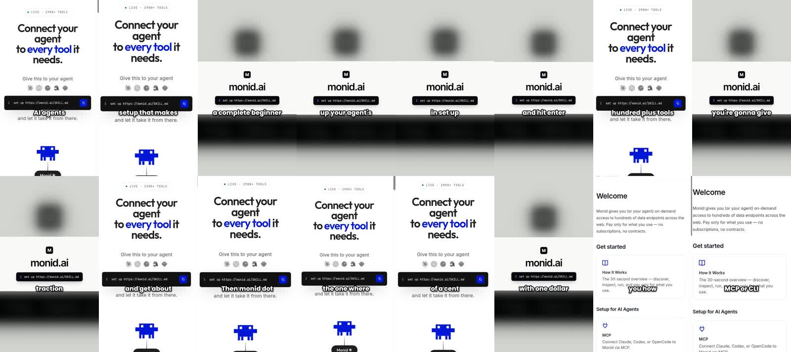

# Creative engine, first live run: monid.ai (2026-11-07)

This is the first end-to-end run of the creative engine on `dylan/video-pipeline`, after the
rebuild described in `docs/creative-engine.md`. It produced two videos, set to 2 per campaign with
1 QC retry. Compare them with the six earlier samples in `samples/monid/`.

- `*.mp4`: compressed copies, 540 px wide. The originals are 1080x1920 in `data/media/`.
- `*-frames.jpg`: contact sheets. Agents that can't play video should look at these.

## Verdict

**Better than the earlier six, not ready to post.**

What works:
- The research finds the right videos.
- The scripts are real remakes of viral videos.
- The presenter is realistic and stays the same person in every shot.
- Captions and hook text are added in the edit, with no garbled text.

What doesn't: **product visuals.** We only have a couple of static screenshots, while the viral
references are mostly motion graphics: UI cards, timers, app windows, terminals.

## What each agent did

| Step | Result |
| - | - |
| Research planner | Category "AI agent tool marketplace". Competitors RapidAPI, Composio, Smithery, Zapier MCP, Apify. 5 kinds of search phrase. |
| Research (Monid) | 30 of 30 sources, about 90 short videos, $0.07 |
| Scout | Flagged the 2.5M-view `#api` clips as off-topic tag reuse and found `#composiopartner` (a competitor's paid creator program, 50-3,500x followers). Ran 5 follow-up searches. |
| Product analyst | "You give your AI agent one setup link, and it can find and use thousands of tools and APIs, paying per call from a single balance." Software. 1 usable site image. |
| Site capture | 2 phone-size screenshots (homepage, docs) |
| Relevance screen | Kept 8 of the 24 top-ranked videos. Dropped the `#api` emoji loop, news clips, a stop-sign clip, and an off-topic `#composiopartner` post. |
| Breakdowns | 6 videos, every line verbatim with timing, cuts and frames (table below) |
| Director (`nomen-director`) | Campaign "One link, every tool": a split-screen remake of @viralex.aii and a faceless remake of @ai.with.ni |
| Script room | 2 rounds of writer, linter and critic. Both scripts ended at 7/10 (the critic wanted product screens we don't have). |
| Production | Veo 3.1 presenter shots, QC, continuity check, silence trim, edit |

### The references it found

| Creator | Views | Followers | x followers | Length | Fit |
| - | - | - | - | - | - |
| [@viralex.aii](https://www.tiktok.com/@viralex.aii/video/7703911645583592736) | 519,894 | 5,656 | 92x | 84 s | 8/10 |
| [@businessliam](https://www.tiktok.com/@businessliam/video/7694052432443165983) | 191,072 | 1,867 | 102x | 58 s | 7/10 |
| [@ai.with.ni](https://www.tiktok.com/@ai.with.ni/video/7609623318043380999) | 1,225,058 | 11,720 | 105x | 63 s | 7/10 |
| [@aethalbeorn](https://www.tiktok.com/@aethalbeorn/video/7682475182115540254) | 1,521,506 | 23,405 | 65x | 75 s | 7/10 |
| [@rakos.media](https://www.tiktok.com/@rakos.media/video/7660311471603141901) | 2,234,427 | 28,197 | 79x | 10 s | 6/10 |
| [@empeer.den](https://www.tiktok.com/@empeer.den/video/7694747291504233780) | 595,778 | 757 | 596x | 10 s | 5/10 |

## Video 1: split-screen remake of @viralex.aii

[v1-split-screen-viralex-remake.mp4](v1-split-screen-viralex-remake.mp4) · 33 s · QC 8/10 on every
shot · same person in every shot (continuity check) · $25.92

**The hook, remade:**
- Reference: "Everybody's editing their reels with Claude right now, but the setup, they lock it
  behind paid courses."
- Ours: "Everybody's giving their AI agents tools right now, but the setup, it's a sign-up and an
  API key for every single one."

It then keeps the reference's "Give me one minute, and I'll show you all of it" and its numbered
steps.

**Good:**
- A realistic presenter, framed as if the phone is propped up.
- No drawn-in text.
- Monid's real homepage on the bottom half.
- Captions and step labels.

**Bad:**
1. **The bottom half is the same homepage crop for 33 s.** The reference changes its graphic on
   every sentence.
2. **Labels and captions collide** with the screenshot's own headline ("to every tool it needs").
3. **It runs 33 s for a 25.5 s script.** The silence trim only cut one shot, because room tone
   stays above the -32 dB threshold.
4. **The step numbers skip** from 01 to 03.
5. **Cost.** About half of the $25.92 was re-renders caused by two bugs fixed during the run
   (below). A clean run is about $13.

## Video 2: faceless remake of @ai.with.ni

[v2-faceless-ai-with-ni-remake.mp4](v2-faceless-ai-with-ni-remake.mp4) · 47 s · text-to-speech
voice-over · a few cents

**The hook, remade:**
- Reference: "Everyone talks about vibe coding, but nobody shows you the actual setup that makes it
  work."
- Ours: "Everyone talks about AI agents using tools, but nobody shows you the actual setup that
  makes it work."

It then keeps the reference's step-by-step walkthrough, and even its filler ("Uh, it's pretty much
gonna…").

**Good:** the script is the closest remake of the two, and every fact comes from Monid's site.

**Bad:**
- It cycles 2 images for 47 s.
- The reference filmed someone actually doing the setup on a screen, and we can't show that yet.

## Bugs the run found, all fixed and committed

| Bug | Effect | Fix |
| - | - | - |
| Ranking by numbers alone | Picked an `#api` emoji loop, a news slideshow and a meme | Relevance screen (`creative/relevance.ts`) |
| Breakdown output limit | 55-85 s references came back empty | 12k tokens, at most 14 beats |
| Naive browser options | `os: "mobile"` and similar left the browser "unavailable"; 0 screenshots | Live-tested config |
| Critic output limit | The critic never reviewed; the script showed a fake 1/10 | 10k tokens, JSON retry, an honest "unavailable" |
| Edit directions in video prompts | Veo drew gibberish captions and cards | Presenter-only prompts (`presenterOnly`) |
| QC frame rebuild | Quoted gibberish was pasted into the image prompt, and the bad frame was reused | Quotes stripped, text defects rebuild from identity |
| Shot lengths | 4/6/8 s renders left dead air | Silence trim (works on 1 of 5 shots, see above) |
| On-camera cost | 60-85 s references would cost $25-35 to remake | On-camera remakes capped at 24 s |

## What to build next, in order

1. **Screen builder.** For every product beat, an agent builds the screen the reference showed (a
   terminal with `set up monid.ai/SKILL.md`, the agent connecting, `monid.discover()` returning
   ranked tools, the balance ticking down). It uses Monid's real wording and styling, rendered with
   headless Chrome (tested on this Mac) as moving footage.
   - It is the fix for both videos: the viral dev videos here are mostly graphics, with the
     presenter as an inset (see the @viralex.aii reference).
2. **Layout that copies the reference.** Presenter as a small inset or a top or bottom strip, as
   the reference does it. Captions in a clear band so they never sit on screenshot text.
3. **Tighter silence trim.** Measure each clip's noise floor instead of using a fixed -32 dB.
4. **A spend counter for the agents.** Model, speech and browser calls don't show in the
   campaign's spend yet. The true cost came from the Naive balance: $174.69 to $145.39.
5. **Try HeyGen Avatar IV** (in Naive's catalogue) for one continuous presenter take with one
   voice, instead of stitched 8 s Veo shots.

## Face swap test (local only)

Naive's Mira swapped our AI presenter into the first 10 s of the @viralex.aii video for $1.48. It
kept the motion and graphics cleanly. The graphics still say Claude, so a swap alone doesn't make a
Monid ad. The output stays in `data/media/swap-test/`, outside the repo.
