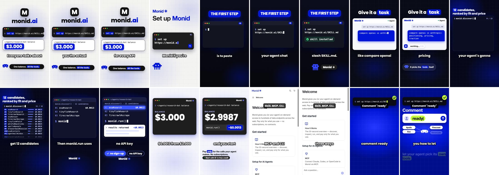
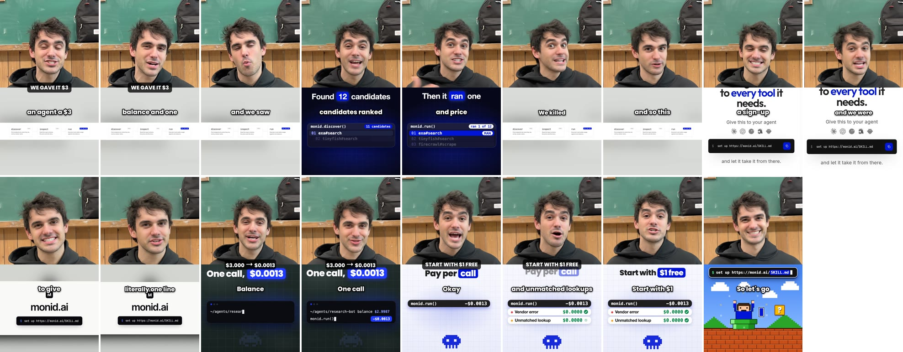

# Creative engine, second live run: monid.ai (2026-11-07)

This run is the first with the screen builder, the brand kit, the benchmark lane and the relevance
screen. It made two videos, set to 2 per campaign with 1 QC retry. Compare it with the first run
in `samples/monid-v2/`.

- `*.mp4`: compressed copies, 540 px wide. The originals are 1080x1920 in `data/media/`.
- `*-frames.jpg`: contact sheets, one frame every 2 s. Agents that can't play video should look at
  these.

## Verdict

**Video 1 (faceless) is the first output that looks like a real product video.** Every beat shows a
screen built from Monid's real command, tool names, prices and balance, in Monid's style.

**Video 2 (presenter) has the best presenter yet, but a weak bottom half.**
- **Presenter:** the same realistic person in all five shots, in the reference's look (black hoodie,
  green chalkboard classroom, smug delivery).
- **Bottom half:** on four beats it shows a banner-shaped diagram as a thin strip.
- **Cost:** it took two rounds of renders. The first round was wasted by a prompt bug (below).

**Neither video looks like the reference.** Both copy the reference's script and structure:
- **Video 1:** the reference films a monitor with a phone, and we have no such format yet, so it
  became animated screens.
- **Video 2:** the reference is a green-screen presenter over screenshots; ours is a split screen.

## What ran on its own, and what I did by hand

The app's agents did the research, planning, writing and production. I did these things by hand:

- **Linked Monid's public repo** (`github.com/monid-ai/monid`), through the app's Brand kit tab, as
  a user would.
- **Started the campaign**, using the same API call as the New campaign button.
- **Re-planned the b-roll of both videos** after fixing the planner mid-run (below). From the next
  campaign on, the planner does this itself.
- **Re-planned video 2's presenter prompts** after fixing the bug that dropped the presenter's
  description, and reset its frames.
- **Gave one stuck frame request a fresh key**, before the automatic re-key existed.
- **Restarted the dev server five times** so the worker loaded the fixes. The worker resumes from
  SQLite.

## What each agent did

| Step | Result |
| - | - |
| Research planner | Category "AI agent tool marketplace". Competitors RapidAPI, Composio, Smithery, Zapier MCP, Apify. **Benchmarks: Cluely, Duolingo** (new lane). |
| Research (Monid) | 33 of 33 sources, 90 short videos (7 from the benchmark lane), 16 ads, $0.07 |
| Scout | Flagged most breakout videos as off-topic (Duolingo memes, Composio-partner comedy). Kept the "I wish I knew this sooner" discovery hook. |
| Brand kit | Repo scan: README pitch, 7 commands, 3 diagrams (`monid-hero.png`, `monid-compile.png`, `monid-verbs.png`) |
| Product analyst | "Monid gives your AI agent one balance and one skill file so it can find and use thousands of tools and APIs without signing up for each one." 4 visuals, 3 from the brand kit. |
| Relevance screen | Kept 4 of the top 24. Dropped the Duolingo memes ("no transferable format") and off-topic comedy. |
| Breakdowns | 4 of 4, line by line with timing |
| Director | Campaign "No more sign-ups for your agent": a faceless remake of @ai.with.ni and a split-screen remake of Cluely's billboard video |
| Script room | Video 1 scored 8/10 from the critic. Video 2 scored 6/10: the critic flagged that it held one diagram on most beats. |
| Screen builder | Video 1: 8 screens. Video 2: 4 screens; one was retried after Naive was at capacity. |

### The references

| Video | Views | Followers | x followers | Likes | Saves | Shares | Length |
| - | - | - | - | - | - | - | - |
| [@ai.with.ni: "Everyone talks about vibe coding, but nobody shows you the actual setup"](https://www.tiktok.com/@ai.with.ni/video/7609623318043380999) | 1,225,093 | 11,720 | 105x | 50,585 | 41,267 | 3,213 | 63 s |
| [@cluelyextras: "We spent $400,000 on these billboards"](https://www.tiktok.com/@cluelyextras/video/7544005050146770189) (benchmark) | 628,239 | 2,969 | 212x | 27,195 | 1,587 | 131 | 62 s |
| [@alli.growth3: "I made $5,000 last month as a full-time university student"](https://www.tiktok.com/@alli.growth3/video/7640262586189106452) | 157,503 | 1,133 | 139x | 12,054 | 9,585 | 805 | 50 s |
| [@empeer.den: "API key" meets "OpenAI" love-song meme](https://www.tiktok.com/@empeer.den/video/7694747291504233780) | 596,701 | 758 | 597x | 19,781 | 2,924 | 1,581 | 10 s |

"x followers" is views ÷ followers, counting accounts under 1,000 followers as 1,000, as the
ranking does.

## Video 1: faceless remake of @ai.with.ni

[v1-faceless-walkthrough-ai-with-ni-remake.mp4](v1-faceless-walkthrough-ai-with-ni-remake.mp4) ·
38.5 s · text-to-speech voice-over · screens, voice and model calls only, a few dollars at most
(not tracked per video yet)

**The hook, remade:**
- Reference: "Everyone talks about vibe coding, but nobody shows you the actual setup that makes it
  work."
- Ours: "Everyone talks about AI agents, but nobody shows you the actual setup that stops you
  signing up for every API."

It keeps the reference's steps ("The first step is…", "The next step is…"), its filler ("pretty
much gonna") and its "comment 'ready'" ending.

**Good:**
- A built screen for every step: `set up https://monid.ai/SKILL.md` typing into a terminal, the
  agent chat with the example task, `monid.discover()` ranking 12 real tools with prices,
  `monid.run()`, and the balance ticking from $3.000 to $2.9987.
- Every fact is from Monid's site or repo.

**Still wrong:**
- **The docs screenshot beat.** The "Skill. MCP. CLI." label and the captions sit on the page's own
  text.
- **"skill installed"** is not real Monid output; the writer made it up. The critic flagged it.
- A screen's first frame is sometimes nearly empty (the discover screen before its rows type in).

## Video 2: presenter remake of Cluely's billboard video

[v2-split-screen-cluely-remake.mp4](v2-split-screen-cluely-remake.mp4) · 34 s · QC 7/10 · same
person in every shot · $27.55 in renders and frames: about half was the first round, lost to the
prompt bug

**The hook, remade:**
- Reference: "We spent $400,000 on these billboards, and we saw, wow, these are getting millions of
  views."
- Ours: "We gave an agent a $3 balance and one skill file, and we saw, wow, it found 12 candidates
  ranked by fit and price."

It keeps the reference's "we were like" quotes and its smug founder delivery.

**Good:**
- The presenter is realistic and stays the same person, with the reference's wardrobe and room.
- Built screens on the product beats: `monid.discover()` ranking 12 tools, `monid.run()`, and the
  balance ticking down.
- The hook overlay "WE GAVE IT $3" at the seam.

**Bad:**
1. **A banner image as a thin strip** on four beats: Monid's 1920x330 "discover / inspect / run"
   diagram in a near-square panel. Fixed for the next run (ff642e0).
2. **Captions on the homepage screenshot** collide with its own headline ("to every tool it
   needs").
3. **It runs 34 s for a 25.5 s script.** Veo speaks slowly to fill 8 s shots.
4. **The script is a 6/10.** The critic wanted presenter-only beats where the reference has them,
   and more screen changes.

## Bugs this run found, all fixed and committed

| Bug | Effect | Fix | Commit |
| - | - | - | - |
| Planner held one still across beats | Video 2's bottom half showed the same diagram on 4 of 8 beats, last run's main defect again | A beat that would repeat the last still, show one a third time, or has none gets a screen built from its own line | a5d8a41 |
| Small site photo full-frame | A blurred, letterboxed logo for 3 s | For software, photos become screens built around them; screenshots and clips stay | a5d8a41 |
| Screen clips looped | The voice-over ran past a 4.5 s screen, which restarted mid-sentence | Short clips hold their last frame | a5d8a41 |
| Voice-over too slow | 48 s for a 38.5 s script: the default voice reads 186 wpm, the reference 249 | Speed set from the script's pace, then time-stretched to length if still over (at most 1.3x) | a5d8a41, 79d55fe |
| Silence trim skipped clips | Veo ends every clip with a click in the last ~50 ms, so the trailing silence never reached the end | Silence within 0.3 s of the end counts | a5d8a41 |
| Re-planned videos rebuilt every screen | Slow and costly | Screens build incrementally from the manifest | a5d8a41 |
| "At capacity" counted as a failed screen | One beat fell back to a still for good | Busy-model failures retry on later ticks (up to 3); the edit waits | 79d55fe |
| Bad first frame animated anyway | Shot 1's still had an Instagram story UI and the wrong outfit; all 5 shots copied it and failed QC after rendering (about $16 wasted) | A vision check of each first frame before the render; bad stills are remade first (cents, not dollars) | 6b75042 |

### Found while finishing video 2

| Bug | Effect | Fix | Commit |
| - | - | - | - |
| The presenter's description vanished from prompts | The edit-direction filter dropped any sentence containing "logo", so "Man, 20s, …, plain black hoodie with no logo, …" was removed entirely. Frames had no presenter: a random person, phone UI drawn in, and every shot failed QC on wardrobe. | Descriptions are filtered clause by clause; "no logo" wording is dropped instead of the outfit. Frame prompts no longer name phones or status bars. | 2583ece |
| A frame request stuck "in flight" at Naive | A server restart while Naive was at capacity left one request's key in flight for 20+ minutes; the worker waited forever | After 10 minutes in flight, ask again under a fresh key | 3e0a04e |
| Banner images in split panels | See video 2, bad 1 | Banner-shaped images and software photos get screens in every panel | ff642e0 |

The first-frame gate caught four bad stills before any render: two with phone UI, two with text
printed on the hoodie.

## Known weak spots, not fixed

- **The benchmark search keeps fan content.** A video that mentions the benchmark brand passes, so
  "Duolingo" returned fan memes. The relevance screen caught them this time. Better: keep only the
  brand's own accounts and its tagged creators.
- **Per-video spend misses screens, voice and model calls.** The true cost comes from the Naive
  balance.
- **The worker does not reload code.** A code change needs a server restart to reach a running
  campaign.
- **No "filmed screen" format.** Walkthrough references filmed on a monitor come out as clean
  animations. Being built.
- **Ranking rewards reach, not conversion.** A tutorial with 41K saves is not necessarily a video
  that sells. The research steering is being reworked (reach and convert roles, ad-library and
  save/share signals).

## Spend

- Naive: $144.98 to $115.04 (**$29.94**). Video 2's renders and frames were $27.55 of that, about half
  of it the first round lost to the prompt bug. Video 1, research, breakdowns, scripts and screens
  were the other ~$2.40.
- Monid: **$0.07**.
