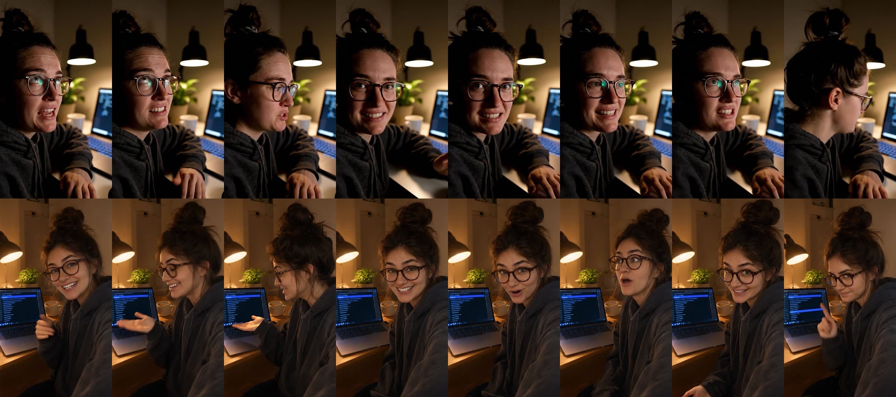
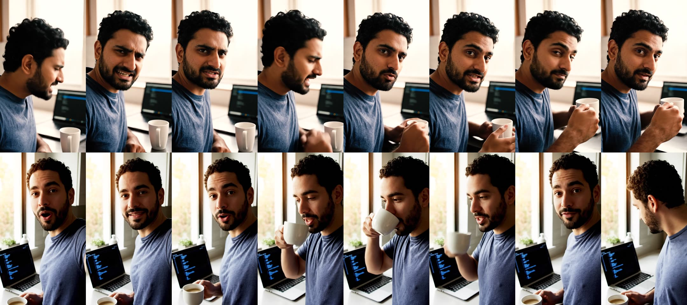
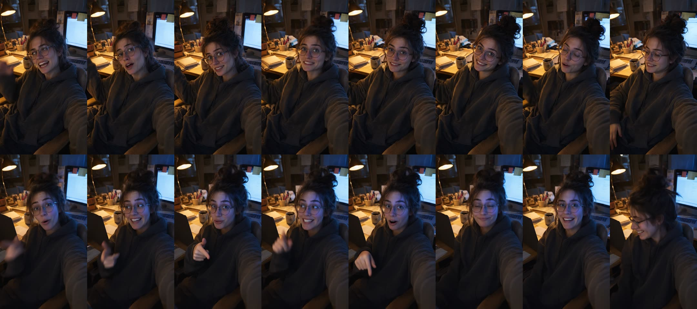
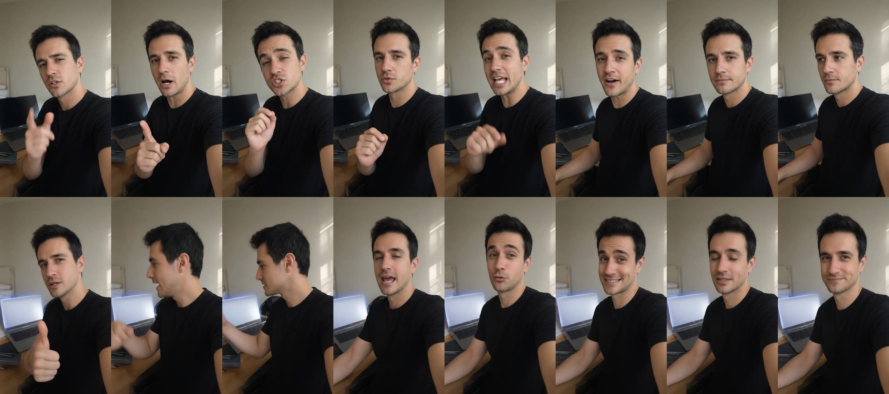
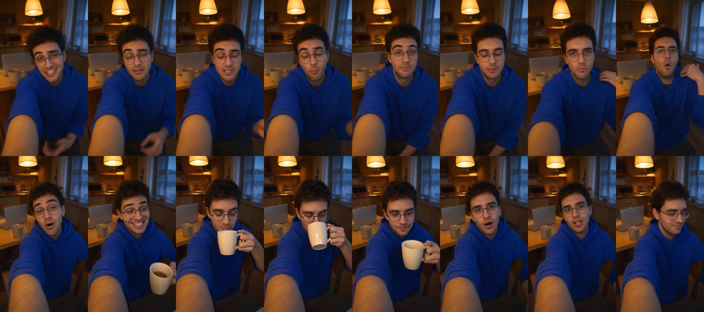
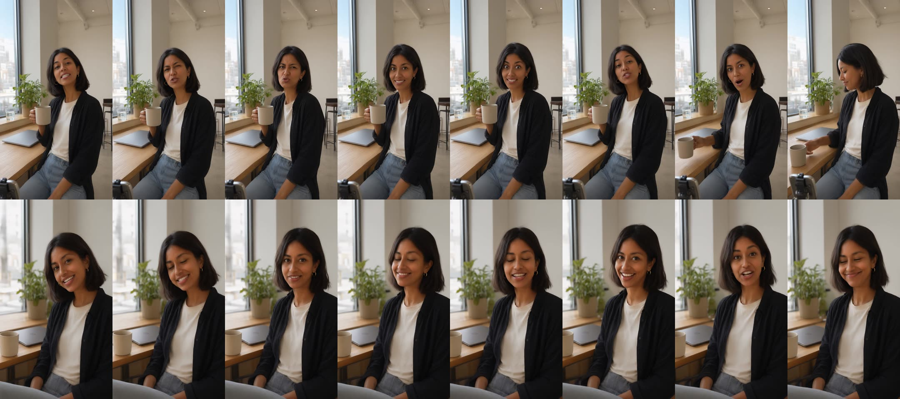

# Sample output: monid.ai test campaigns

Six real videos Nomen produced for https://monid.ai on 2026-11-07, across three runs, each one the pipeline's final, stitched 16-second ad (two 8 s Veo 3.1 shots). They are here so whoever iterates on video quality can see exactly where it falls short.

- `*.mp4`: compressed copies (540 px wide) for people to watch. The originals were 1080x1920.
- `*-frames.jpg`: one frame per second, 16 frames in two rows (row 1 = shot 1, row 2 = shot 2). Agents that cannot play video should look at these.
- QC scores are from Nomen's own vision check (`src/lib/qc.ts`): 7+ passes.

## Honest verdict

None of these is good enough to post for a client yet. Every fix since run 1 is in the code; the remaining gaps are listed under **What to improve next**.

## Run 1

Run 1 (before the identity fix): every shot was rendered without a first frame because of an Idempotency-Key bug, so shot 2 is a DIFFERENT PERSON from shot 1. Laptop screens show gibberish code. Unusable.

### Stop signing up for APIs  (QC 7/10, $6.44 on Naive)

Video: [run1-stop-signing-up-for-apis.mp4](run1-stop-signing-up-for-apis.mp4) · format: Problem/solution UGC selfie, 16 seconds

**Creator:** A woman in her late 20s with a messy dark-brown bun, round tortoiseshell glasses, a charcoal hoodie and a relaxed, dry-humored energy

**Setting:** A small home office desk in the evening, warm desk lamp plus the cool glow of a laptop, a plant and a mug in the background

**Shot 1** (1 render(s), provider naive, QC n/a/10)

- Note: quality check skipped: naive: the model returned a malformed tool call

Final video prompt

Vertical 9:16 handheld smartphone video, UGC style. Selfie at arm's length with slight natural shake. A woman in her late 20s with a messy dark-brown bun, round tortoiseshell glasses, a charcoal hoodie and a relaxed, dry-humored energy sits at a small home office desk in the evening, warm desk lamp plus the cool glow of a laptop, a plant and a mug in the background. She sighs, rolls her eyes toward the laptop beside her, then looks back at the camera with a wry half-smile. The laptop shows a dark near-black terminal window with a blue (#2d5bff) accent, too small to read. She says: "My agent needed six tools. So that's... six sign-ups. Six keys. Six bills." Tone: dry, tired, funny. Audio: voice close to the mic, quiet room tone, soft keyboard click. Photorealistic, natural skin texture, realistic hands, no on-screen text, no captions, no logos other than the product's own label.

**Shot 2** (1 render(s), provider naive, QC 7/10)

- QC: The hand in frame 2 is a smeared, ambiguous blob at the bottom of the frame. It reads as motion blur but looks slightly AI-like.
- QC: Frame 1 has the hand hovering over the laptop keyboard with slightly elongated fingers, and the gesture reads as a staged presenter pose rather than a casual nod.
- QC: The laptop and screen shift between frames. Frame 4 shows a different angle and a second blue highlight bar, so the shot is not fully continuous.
- QC: The terminal text is small and blurry with a few near-legible garbled strings. It is acceptable at this distance, but no balance readout is visible in the corner.
- QC: Frame 1's face has a wider, posed grin that feels slightly different from the other frames. Identity holds overall, but it is a little less consistent there.
- QC: The framing is a clean selfie, but the action leans on pointing and open-hand gestures instead of the brief's head nod toward the laptop and turn back.

Final video prompt

Vertical 9:16 handheld smartphone video, UGC style. Selfie at arm's length with slight natural shake. A woman in her late 20s with a messy dark-brown bun, round tortoiseshell glasses, a charcoal hoodie and a relaxed, dry-humored energy at a small home office desk in the evening, warm desk lamp plus the cool glow of a laptop, a plant and a mug in the background. She nods toward the laptop, which shows a dark near-black terminal window with a ranked list highlighted in electric blue (#2d5bff), unreadable at this distance, then turns back to the camera, relieved. She says: "Monid is one line. Your agent finds the tool, runs it, pays per call. One balance." Tone: relieved, casual, a little amused. Audio: voice close to the mic, quiet room ambience, a soft notification chime. Photorealistic, natural skin texture, realistic hands, no on-screen text, no captions, no logos other than the product's own label.

### Stop paying for tools you barely use  (QC 5/10, $9.60 on Naive)

Video: [run1-stop-paying-for-tools-you-barely-use.mp4](run1-stop-paying-for-tools-you-barely-use.mp4) · format: Myth-busting talking head with a quick demo, 16 seconds

**Creator:** A man in his early 30s with short curly black hair, a trimmed beard, a faded navy t-shirt and an easygoing, deadpan energy

**Setting:** A bright kitchen counter in the morning, soft window daylight, a laptop open on the counter and a coffee cup beside it

**Shot 1** (2 render(s), provider naive, QC 5/10)

- QC: Frame 1 expression is a pained, squinting grimace with bared teeth. It reads as distress or disgust, not a deadpan, slightly smug eyebrow raise, and the teeth and mouth look slightly distorted.
- QC: The action doesn't match the brief. The man turns to full profile and looks down at the laptop, then gestures with an open hand, then sips or holds a mug. The slow head shake and the quick glance at the laptop and back are missing, and the mug handling isn't in the brief.
- QC: In frame 3 a large, motion-blurred open hand fills the lower right. It is oversized, with stretched fingers, and it covers the mug. This looks like an AI artifact and breaks the realistic-hands requirement.
- QC: The framing doesn't feel like an arm's-length selfie. He is cropped very tight and sits off to one side, and he is turned away from the lens in frame 2. The camera feels like a separate cinematographer's, not a phone held in his own hand.
- QC: The laptop screen is angled toward the camera and mostly in focus, and it looks like a generic dark UI with a blue bar. It has no clear Monid terminal, ranked-list or balance-readout cues. It is at least not legible.
- QC: The look is cinematic and over-processed, with a heavy shallow-depth-of-field blur and a soft, glowing window. It looks more like a polished AI render than a casual phone video.

- Note: first frame skipped: naive: a request with this Idempotency-Key is still in flight; retry once it has completed

Final video prompt

Vertical 9:16 handheld smartphone selfie video, UGC style, slight natural shake, phone held at arm's length so the arm stays out of frame except a small natural edge of the shoulder. A man in his early 30s with short curly black hair, a trimmed full beard, and a faded navy t-shirt stands at a bright kitchen counter in soft morning window daylight (exposed so the window is not blown out). He has an easygoing, deadpan expression. A coffee mug sits fully in frame on the counter beside an open laptop, set a little behind him and slightly to the side. The laptop is angled away and slightly out of focus, shallow depth of field. Its screen shows only a dark near-black terminal window with a thin blue (#2d5bff) highlighted bar and a tiny corner readout, with no legible text and no code editor UI or white panels. He raises one eyebrow and slowly shakes his head, then glances briefly at the laptop and back to the lens with a subtle smug half-smirk. He says, in a dry, deadpan voice: \"Your agent doesn't need twelve subscriptions. It uses a tool, what, twice a week?\" Mouth movement is natural and the face stays consistent, with no exaggerated grin. Natural skin texture, realistic hands (if visible, five well-formed fingers), consistent identity throughout. Audio: voice close to the mic, quiet kitchen ambience, one soft mug clink. No on-screen text, no captions, no logos."}

**Shot 2** (1 render(s), provider naive, QC n/a/10)

- Note: quality check skipped: naive: the model returned a malformed tool call

Final video prompt

Vertical 9:16 handheld smartphone video, UGC style. Selfie at arm's length with slight natural shake. A man in his early 30s with short curly black hair, a trimmed beard, a faded navy t-shirt and an easygoing, deadpan energy at a bright kitchen counter in the morning, soft window daylight, a laptop open and a coffee cup beside him. He picks up the coffee, takes a small sip and gives a satisfied shrug toward the laptop, which shows a dark near-black terminal with a blue (#2d5bff) highlighted list, unreadable. He says: "With Monid it's one balance. You pay per call. Starts at a dollar of free credit." Tone: calm, matter-of-fact, a little pleased. Audio: voice close to the mic, soft kitchen ambience, a light sip sound. Photorealistic, natural skin texture, realistic hands, no on-screen text, no captions, no logos other than the product's own label.

## Run 2

Run 2: identity holds (same person in both shots, confirmed by the continuity check), but monitors and laptop screens face the camera with fake text, and the creators point, thumbs-up and turn their heads fast, which renders distorted. QC 4/10 after re-renders.

### Twelve sign-ups  (QC 4/10, $12.88 on Naive)

Video: [run2-twelve-sign-ups.mp4](run2-twelve-sign-ups.mp4) · format: Problem/solution talking head

**Creator:** A woman in her late 20s with a messy dark-brown bun, round glasses, a charcoal oversized hoodie, tired but wry, relaxed energy

**Setting:** A cluttered home-office desk in the evening, warm desk-lamp light with a cool blue monitor glow, a laptop angled away from camera

**Continuity check:** same person: Both shots show the same woman with a messy dark bun, round glasses and a charcoal hoodie, in the same cluttered desk setup with a warm lamp, a blue monitor glow, a mug and a pen cup; only her expression and pose differ.

**Shot 1** (2 render(s), provider naive, QC 4/10)

- QC: A monitor faces the camera in frames 1, 2 and 4, and its screen shows a white document-like page with sticky notes. The brief says no readable screens and the laptop angled away.
- QC: The expression doesn't match the brief. She has a wide, toothy, eager grin in frames 1 and 3, with wide eyes in frame 3. The brief asks for a deadpan, tired, wry look with a small smile. Frame 4 shows her eyes closed or squinting.
- QC: The action doesn't match. She never visibly glances at the laptop and then delivers a flat look to the lens. Her gaze goes sideways or off-camera in most frames, and she looks to camera only in frame 3, and then with a grin. The body is mostly static rather than slumping.
- QC: Her free hand is raised in an odd, unmotivated pose: it touches her head in frame 1 and sits half out of frame at the left edge in frames 2 to 4. The hand is cropped or ambiguous.
- QC: The selfie arm and sleeve take up a large part of the lower right of the frame, though the brief asked for only a sliver. The framing is cluttered and the camera angle is high and awkward.
- QC: The scene is very dark and murky. It has no clear cool blue monitor glow, so the warm and cool lighting contrast is weak.

Final video prompt

Vertical 9:16 handheld smartphone selfie video, UGC style, shot at arm's length with slight natural shake and a natural phone-camera look (mild noise, slightly overexposed lamp). A woman in her late 20s with a messy dark-brown bun, round glasses and a charcoal oversized hoodie sits at a cluttered home-office desk in the evening. The scene has warm desk-lamp light plus a soft cool blue-and-white glow from behind her. A laptop sits at the edge of frame, angled completely away from the camera, so only the back of its lid and a faint blue-white glow on the desk are visible. No monitor facing the camera, and no readable screens, documents or sticky notes. She starts upright, then slumps back in her chair with a small sigh and glances sideways at the laptop. She then looks straight into the lens with a flat, deadpan expression and a small tired, wry smile, with relaxed brow and eyes and no grimacing or wide-eyed panic. She says in a dry, flat tone: "My agent needs twelve different tools. That's twelve sign-ups. Twelve keys. Twelve bills." Her free hand rests relaxed on the armrest or in her lap, with realistic five-finger hands. The selfie arm is kept mostly out of frame, with only a small natural sliver of sleeve at the edge. Keep the same face and identity throughout. Audio: voice close to the mic, quiet room ambience, a faint chair creak. Photorealistic, natural skin texture, well exposed enough to see her face clearly, with no on-screen text, no captions and no logos.

**Shot 2** (2 render(s), provider naive, QC 4/10)

- QC: The monitor on the right faces the camera with a bright white screen, visible document-like lines and sticky notes. The brief says no readable screens, only a soft blue-and-white glow, so this is a brand-rule violation.
- QC: The gesture doesn't match the brief. In frame 1 she points a thumb and finger at the lens instead of tapping once in the air toward the laptop. In frame 2 the hand is a motion-blurred smear.
- QC: The hand in frame 1 looks awkward, with the thumb and index finger in an odd, slightly malformed pose.
- QC: The expression arc is off. Frame 3 has wide, bug-eyed, uncanny eyes. Frame 4 has her laughing with eyes closed. The brief asks for a wry, relaxed look, then a relieved small smile and a small shrug, with eyes on the lens.
- QC: Identity seems to drift between frames. Her face looks younger and rounder with wider eyes in frames 1 and 3, and more angular in 2 and 4. The glasses sit slightly differently.
- QC: The lighting is too dark and murky. Her face is lit a purple-blue instead of by warm desk-lamp light, so it looks more like a moody film still than a balanced phone video.

Final video prompt

Vertical 9:16 handheld smartphone selfie video, UGC style, natural slight shake, arm's length, normal phone front-camera lens with no fisheye distortion. A woman in her late 20s with a messy dark-brown bun, round glasses, and a charcoal oversized hoodie, tired but wry, relaxed energy, sits at a cluttered home-office desk in the evening. Warm desk-lamp light falls on her face, with a faint cool blue glow in the background. Behind her, a laptop is angled completely away from camera and a monitor is turned away or heavily out of focus, so only a soft blue-and-white glow is visible and no text, UI, or sticky notes can be read. She sits up, taps one finger once in the air toward the laptop off to the side, then turns to look directly into the lens with a relieved, small smile and a small natural shrug. Eyes open and on the lens when she speaks. She says: "Or one skill line. [short pause] Agent finds the tool, runs it, pays per call. One balance." Easy, genuine, understated tone. Audio: voice close to the mic, quiet room ambience, one soft keyboard tap. Photorealistic, natural skin texture with visible pores, brightness balanced as on a real phone, realistic hands with five clear fingers, consistent face and glasses throughout. No on-screen text, no captions, no logos.

### The tool list your agent didn't have  (QC 4/10, $9.72 on Naive)

Video: [run2-the-tool-list-your-agent-didn-t-have.mp4](run2-the-tool-list-your-agent-didn-t-have.mp4) · format: Myth-busting / resource reveal

**Creator:** A man in his mid-30s with short black hair, light stubble, a plain black t-shirt, calm low-key teacher energy

**Setting:** A tidy bedroom-office with a neutral wall in soft late-morning window light, a laptop angled away on the desk behind him

**Continuity check:** same person: Both shots show the same dark-haired man with light stubble in a plain black t-shirt, in the same neutral-walled room with soft window light and a laptop angled away on the desk; only the pose and the laptop screen glow differ slightly.

**Shot 1** (1 render(s), provider naive, QC 7/10)

- QC: No critical defects: hands, teeth, and face look natural, and identity is consistent across the four frames.
- QC: Frames 2 and 4 catch him mid-blink or with eyes closed. Frame 4 reads as sleepy rather than a patient teacher look, so the edit should avoid holding on it.
- QC: The laptop screen faces the camera instead of being angled away. It is dark and unreadable, so it is acceptable, but it does not match the brief's blue-and-white glow.
- QC: Frame 2 has motion blur on the raised hand and a half-closed eye, which looks slightly awkward when paused.
- QC: The raised finger in frame 1 is clear, but the lowering in frame 2 looks like a loose fist rather than a deliberate gesture. This is minor.
- QC: The face fills much of the frame and sits close to the top edge. The framing is still vertical and reads as a real selfie.

Final video prompt

Vertical 9:16 handheld smartphone video, UGC style. Chest-up selfie at arm's length with slight natural shake. A man in his mid-30s with short black hair, light stubble, a plain black t-shirt, calm low-key teacher energy, in a tidy bedroom-office with a neutral wall in soft late-morning window light, a laptop angled away on the desk behind him with its screen not visible. He raises one finger toward the lens, then lowers it with a patient look. He says: "Your agent isn't dumb. You just gave it three tools. It can't use what it can't find." Calm, level, matter-of-fact tone. Audio: voice close to the mic, soft room tone, a faint distant street hum. Photorealistic, natural skin texture, realistic hands, no on-screen text, no captions, no logos other than the product's own label.

**Shot 2** (2 render(s), provider naive, QC 4/10)

- QC: Frame 1: big thumbs-up toward the lens. The brief said no big gestures toward the camera, and the hand is oversized and distorted, close to the lens with a bulky thumb.
- QC: The laptop is not angled away. It faces the camera in every frame, and its bright white-grey screen is visible. The brief called for a back or edge view with only a soft glow. The blue outline looks like a neon rim, not a spill of light.
- QC: The over-the-shoulder glance never happens. Frame 2 is a blurry, warped head turn toward the camera side, with his eyes half-closed and his head smeared. He does not clearly look at the laptop and then turn back.
- QC: Facial expression and identity drift between frames. Frame 3 has pursed lips and raised eyebrows. Frame 4 has a wide, stagey grin. This does not read as calm, low-key teacher energy, and there is no small knowing smile or slow nod.
- QC: Frame 2 has a distorted face and head with motion warping. The arm on the left looks stretched and oddly placed. The frames also show background and wall shifts, with a different window and wall, and the arm at the right edge looks odd.
- QC: The AI look is strong overall: the skin is smoothed, the laptop is generic, and the room's perspective wobbles. It does not feel like a real phone video.

Final video prompt

Vertical 9:16 handheld smartphone video, UGC style. Chest-up selfie at arm's length with slight natural handheld shake. A man in his mid-30s with short black hair, light stubble and a plain black t-shirt, with calm low-key teacher energy, sits in a tidy bedroom-office with a neutral wall and soft late-morning window light. Behind him on the desk, a laptop is angled well away from the camera, so we see only its back or edge and a faint soft blue-white glow spilling onto the desk. No screen content is visible and nothing on it is readable. He starts facing the camera, then clearly turns his head and glances over his shoulder at the laptop. He turns back to the lens, gives a slow small nod and a small knowing smile, and says calmly: 'Add one skill file and it searches, compares, and runs the right tool itself.' He pauses briefly after 'itself', then adds: 'Link's in the caption.' Both hands stay relaxed and out of the frame, or rest naturally with five normal fingers. There are no big pointing gestures toward the lens. His face stays the same person throughout, with natural skin texture, natural eyes and teeth, and no warping. Audio: voice close to the mic, soft room tone, one gentle keyboard click. Photorealistic. No on-screen text, no captions, no logos, no readable screens."

## Run 3

Run 3 (all fixes up to then): same person throughout, no readable screens, small natural actions. 'Three Sign-Ups Later' uses an arm's-length selfie, so a huge wide-angle forearm fills every frame. 'We Killed the Subscriptions' (propped-up phone) is the best of the six and is close to usable; QC docked it for a bigger grin than scripted and off-center framing.

### Three Sign-Ups Later  (QC 4/10, $12.96 on Naive)

Video: [run3-three-sign-ups-later.mp4](run3-three-sign-ups-later.mp4) · format: Problem/solution selfie talking head, 16 seconds in two shots

**Creator:** A man in his late 20s with short dark curly hair, light stubble, round glasses, an electric-blue hoodie, relaxed and slightly sleepy dry-humored energy

**Setting:** A small apartment kitchen table in the early evening, warm lamp light mixed with soft blue window light, a closed silver laptop and a ceramic mug on the table behind him

**Continuity check:** same person: Both shots show the same man with dark curly hair, stubble, round glasses and an electric-blue hoodie at the same lamp-lit kitchen table with a laptop and mug behind him; only his pose and expression differ, since he is sipping from a mug in shot 2.

**Shot 1** (3 render(s), provider naive, QC 4/10)

- QC: A giant foreground forearm fills the lower-left of every frame. The prompt explicitly banned this, and it gives a wide-angle selfie distortion.
- QC: The laptop is not fully closed. It looks like an open laptop with a pale screen or lid angled toward the camera, and it changes shape and position between frames. The brief required a closed, flat laptop.
- QC: The mug and laptop shift position and size from frame to frame, so the background is not stable. In frame 4 the mug looks warped.
- QC: The prompt said both hands stay out of frame or rest on the table. Instead his free hand is raised and gesturing in frames 1, 2 and 4, and its fingers look slightly distorted. The hand in frame 4 is awkwardly bent near his ear.
- QC: His eye line is inconsistent. In frame 1 his eyes are half-lidded and looking off-lens. In frame 4 his gaze is slightly off. The brief required eyes straight into the lens.
- QC: His expression and face shift noticeably across frames, and the face in frame 4 looks stretched. Identity is roughly consistent but wobbles.

Final video prompt

Vertical 9:16 handheld smartphone selfie video, UGC style. The phone is held at arm's length in his right hand, which stays out of frame. Only a small, natural sliver of his forearm may appear at the edge. Use a natural phone front-camera field of view (about 26mm equivalent) with NO wide-angle distortion, no giant foreground arm, and no warped room edges. Slight natural handheld shake, a stable horizon, and the same camera position throughout. A man in his late 20s with short dark curly hair, light stubble, round wire glasses, and a plain electric-blue hoodie (#2d5bff) sits at a small apartment kitchen table in the early evening. Warm lamp light is mixed with soft blue window light, and the exposure is bright enough to show natural skin texture. Directly behind him on the table sit a fully CLOSED silver laptop (lid shut, flat, no keyboard or screen visible) and a ceramic mug. Both stay in the same positions in every frame. His eyes look straight into the lens throughout, with only brief natural blinks. His left hand rests on the table or stays out of frame, with no blurry or extra hands. He gives a tired half-smile, raises one eyebrow, says in a dry, deadpan tone 'Your agent needs a scraper, then a voice, then weather.' [short pause] 'That's three sign-ups.', then ends with a small exhale and a slow, clearly visible shrug of both shoulders. Same person, same face, same glasses, and same hoodie in every frame. No physical product, no text, no captions, no logos. Audio: voice close to the mic, quiet kitchen room tone, a faint fridge hum, a soft mug clink at the end. Photorealistic, natural skin texture, correct fingers, natural teeth and eyes.

**Shot 2** (1 render(s), provider naive, QC n/a/10)

- Note: quality check skipped: naive: the quality check returned no verdict

Final video prompt

Vertical 9:16 handheld smartphone video, UGC style, selfie at arm's length with slight natural shake. A man in his late 20s with short dark curly hair, light stubble, round glasses, an electric-blue hoodie, relaxed and slightly sleepy dry-humored energy, sits at a small apartment kitchen table in the early evening, warm lamp light mixed with soft blue window light, a closed silver laptop and a ceramic mug on the table behind him. He smiles, leans back in his chair, relaxes his shoulders, then takes a small sip from the mug and lowers it. He says: "With Monid, one skill, and the agent picks the tool. You pay per call. There's a dollar free to start." in a relaxed, amused tone with a small laugh after 'picks the tool'. Audio: voice close to the mic, quiet kitchen room tone, a soft ceramic clink as the mug is set down. Photorealistic, natural skin texture, realistic hands, no on-screen text, no captions, no logos other than the product's own label.

### We Killed the Subscriptions  (QC 5/10, $19.44 on Naive)

Video: [run3-we-killed-the-subscriptions.mp4](run3-we-killed-the-subscriptions.mp4) · format: Myth-busting talking head, 16 seconds in two shots

**Creator:** A woman in her mid-30s with a shoulder-length dark bob, warm brown skin, small gold hoop earrings, a plain off-white t-shirt under an open black overshirt, calm confident energy with a wry smile

**Setting:** A bright coworking-space corner on a weekday morning, soft diffused daylight from a large window on her left, a plant and a closed laptop on a wooden table behind her, no other people in frame

**Continuity check:** same person: Both shots show the same woman with a dark shoulder-length bob, small gold hoop earrings, an off-white tee under an open black overshirt, and the same bright window corner with a plant and closed laptop on a wooden table, with only small differences in angle and framing.

**Shot 1** (3 render(s), provider naive, QC 5/10)

- QC: Frame 3 has a wide-eyed, exaggerated, startled expression with a big open-mouth grin. It contradicts the brief's calm, deadpan, wry delivery and looks uncanny and cheap.
- QC: Frame 2 shows a broad toothy smile instead of a closed-mouth half-smile, which is off-brief for the flat, matter-of-fact tone.
- QC: The framing is not the brief's locked-off mid-chest shot. She sits at a three-quarter angle with her torso and lap in view and is off-center. Her position and scale drift between frames, and she turns to near-profile in frame 4.
- QC: In frame 4 she turns to profile, looks down with eyes closed, and reaches to set the mug on the table. The prompt forbade this, and it happens too early to read as a natural end beat.
- QC: The creator's face looks slightly different between frames. Frame 1 has a heavier, more neutral face, while frames 2 and 3 are more angular and tanned. That points to a drifting identity.
- QC: A phone or gimbal rig is visible in the bottom-left corner of every frame. It is a distracting, unintended element, and the framing reads as staged rather than genuine UGC.

Final video prompt

Vertical 9:16 UGC-style smartphone video. The phone is propped on a stable surface at eye level and stays locked off, with only a very slight natural handheld micro-shake and no reframing. The same woman appears in every frame: mid-30s, shoulder-length dark bob, warm brown skin, small gold hoop earrings visible in both ears, plain off-white t-shirt under an open black overshirt. Her face, skin tone, hairline and hair volume stay identical throughout. She sits in a bright coworking-space corner on a weekday morning, with soft diffused daylight from a large window on her left. Behind her on a wooden table are a leafy plant and a laptop that is fully CLOSED, lid shut and flat, with no screen or keyboard visible. No other people are in frame. She holds a plain matte mug steadily at chest height in her right hand, with natural, correctly formed fingers. She keeps her body and face squared to the camera and her eyes on the lens for the entire shot. She never turns to profile, never looks down, and never reaches for the table or laptop. Her expression is dry, deadpan and wry, with a subtle closed-mouth half-smile and no wide grin and no showing of teeth except in natural speech. She says in a flat, matter-of-fact tone: \"Stop paying monthly for tools your agent uses twice. [small pause] Seriously. That's the whole subscription problem.\" Her lips sync naturally, and she raises her eyebrows slightly on 'Seriously'. During the line she gives one slow, knowing side-to-side head shake while still facing the camera. Frame her from mid-chest up with a little headroom, with the mug and the closed laptop in view. At the very end she may lightly set the mug down, giving a faint tap. Audio: voice close to the mic, soft coworking room tone with distant keyboard murmur. Photorealistic, natural skin texture with pores, realistic hands and teeth, no on-screen text, no captions, no logos."

**Shot 2** (3 render(s), provider naive, QC 5/10)

- QC: Framing deviates from the brief: the prompt specified her centered and square to the lens, mid-chest to just above the head. She is off-center right with shoulders angled, and the frame runs from the head down to the lap and knee.
- QC: Her knee or leg is visible in the bottom-left corner, and her forearms or hands are partly visible at the bottom edge. The prompt said no hands, arms or knees in frame.
- QC: An extra object appears: a beige ceramic mug on the table. The brief said no other objects.
- QC: The laptop is only partly closed-looking and sits at an angle. It has a faint embossed logo on the lid, which conflicts with 'no logos'. It is also pushed to the table edge rather than sitting clearly behind her.
- QC: The window is on the left of the frame, but the brief placed it on the right side of the frame (her left). The lighting direction is wrong.
- QC: Frame 1 has a head tilt and a closed-mouth smirk, which fits the wry setup. Frames 2-4 become a wide open-mouth grin the whole way through, so the lean-in, small nod and relaxed satisfied smile beat is not visible. The grin also looks stock-photo posed rather than candid.

Final video prompt

Vertical 9:16 smartphone video, UGC style, phone propped on a table at eye level, very slight natural handheld shake, stable framing from mid-chest to just above the head with the subject centered and facing the lens squarely (shoulders mostly square to camera). The same woman throughout every frame: mid-30s, shoulder-length dark bob, warm brown skin, small gold hoop earrings, plain off-white t-shirt under an open black overshirt, calm confident energy. She sits in a bright coworking-space corner on a weekday morning. Soft diffused daylight comes from a large window on the RIGHT side of the frame (her left), lighting her face softly from that side. Behind her on a wooden table are a leafy plant and a CLOSED silver laptop lying flat with its lid fully shut: no screen visible, no keyboard visible, just the closed lid. No other objects, no other people. She looks into the lens with a wry, relaxed half-smile, leans in slightly, gives one small nod, then leans back and relaxes with a satisfied gentle smile. She says: "Monid is one balance, pay per call. Skill, MCP or CLI. First dollar's free." in a warm, easy tone, with a small smile on the last line. Her hands are fully out of frame below the camera line, with no hands, arms or knees visible. Her face, hair, clothing and background stay identical across the whole clip. Natural phone-camera look with a slightly imperfect, casual feel, not a studio portrait. Audio: voice close to the mic, soft coworking room tone, a faint chair creak as she leans back. Photorealistic, natural skin texture, no on-screen text, no captions, no logos.

## What to improve next

1. **Selfie framing.** Arm's-length selfies give a giant distorted forearm. The strategist now asks for a propped-up phone (not yet re-tested).
2. **Expression and action control.** Veo exaggerates grins, closes eyes mid-shot and adds head turns. Try shorter, calmer action lines, or `seconds: 6`, or a second take per shot and let QC pick the best.
3. **Upscaling.** Naive renders Veo at 720p; Nomen upscales with ffmpeg. A real upscaler (`black-forest-labs/flux-video-upscale` is in Naive's catalogue) is untested.
4. **Captions.** Real UGC has burned-in captions; Nomen adds none yet (video models garble text, so this must be done after rendering, e.g. Naive clips `caption_preset` or ffmpeg drawtext from the script).
5. **Physical products.** The product-photo first frame (real packaging in shot) has not been tested end to end: monid.ai has no physical product. Run a consumer brand next.
6. **Cost.** QC re-renders made run 3 cost $16.28 per video; the QC rubric was loosened afterwards to fail only realism defects.
